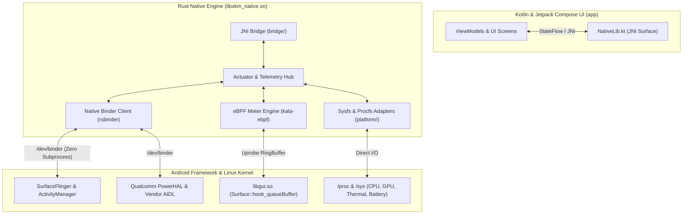

# XKM Native Core (`xkm_native`)

<p align="center">
  
  
  
  
  
</p>

## About `xkm_native`

**`xkm_native`** is the high-performance, zero-allocation native engine powering **Xtra Kernel Manager (XKM)**. Built in modern Rust (Edition 2024), it operates directly inside the application process (`libxkm_native.so`) via JNI and provides low-level system observability, eBPF frame metering, and native Android Binder IPC control.

By interfacing directly with `/dev/binder`, `/proc`, `/sys`, and kernel tracepoints, `xkm_native` completely eliminates the need for shelling out (`su -c "am ..."` or `toybox`), reducing execution latency from **~50–100 ms down to sub-millisecond (< 0.2 ms)** scale without companion APKs.

---

## Architecture Overview



---

## Key Subsystems & Capabilities

### 1. eBPF FPS Meter & Frame Analysis Engine
A zero-overhead frame timing and jank diagnostic pipeline inspired by [Auriya](https://github.com/pavelc4/auriya) and [kala](https://github.com/pavelc4/kala):
- **On-Demand eBPF Uprobe Hook**: Attaches directly to `libgui.so` `Surface::hook_queueBuffer` for the focused target application (e.g. `com.mobile.legends`).
- **Lifecycle Probe Management**: Probe attaches when the target game opens and safely unloads from the kernel upon exit or switch to prevent system churn.
- **Advanced Frame Metrics**:
  - Rolling 60-frame window with 1.35x deadline jank classification.
  - **1% Low** and **0.1% Low** percentile calculations.
  - Frametime variance and Coefficient of Variation (`cv`).
- **SoC Root Cause Diagnosis**: Correlates frame drops against real-time telemetry to report root causes:
  - `Smooth` — Rendering on time.
  - `CpuBound` — CPU load $\ge 90\%$.
  - `GpuBound` — GPU load $\ge 85\%$.
  - `ThermalThrottling` — Thermal zones exceeding severe thresholds.
  - `MemoryPressure` — Available RAM $< 350\text{ MB}$.
  - `AppStall` — Main UI thread or rendering engine blocked internally.
- **Zero-Allocation Sysfs Fallback**: Automatic fallback to 8 vendor display CRTC nodes (`/sys/class/drm/sde-crtc-*/measured_fps`, etc.) with safe UTF-8 character boundary scanning.

### 2. Native Android Binder Actuators (Zero-Subprocess IPC)
Interacts directly with Android's `servicemanager` via `rsbinder` without spawning subshells or JVM companion apps:

| Domain | Interface / Service | Functionality |
|---|---|---|
| **Display** | `SurfaceFlinger` (Codes 45/47)<br>`DisplayManager` (Code 48) | • Active refresh rate query and dynamic mode switching (60Hz, 90Hz, 120Hz).<br>• Direct backlight brightness query and setting. |
| **PowerHAL** | `android.hardware.power.IPower/default` | • Qualcomm vendor AIDL integration.<br>• Toggles `PowerMode::Game`, `SustainedPerformance`, and `ExpensiveRendering`. |
| **Gaming Locks** | `IWifiManager` (Codes 62/64)<br>`IStatusBarService` (Codes 2/4)<br>`IWindowManager` (Codes 59/60)<br>`IVibrator` (Code 2) | • **Wi-Fi Low-Latency Lock** (`WIFI_MODE_FULL_LOW_LATENCY = 4`) with token retention.<br>• **Status Bar / Gesture Lock** (disables notification shade pull-down & back gestures).<br>• **Screen Rotation Lock** (freeze orientation).<br>• **Haptic Silencing** (mute vibrator motor during gameplay). |
| **Touch Boost** | `vendor.lineage.touch.IHighTouchPollingRate`<br>Vendor Sysfs Nodes | • Hybrid high touch sampling rate toggle (240Hz / 480Hz).<br>• Writes LineageOS Touch AIDL and multi-vendor sysfs nodes (`bump_sample_rate`, `game_switch_enable`).<br>• Caches state to overcome write-only OEM kernel drivers. |
| **Task Manager** | `android.app.IActivityManager`<br>`android.app.usage.IUsageStatsManager` | • Native `/proc` process enumerator ranked by RSS memory descending with cgroup tags (`top-app`, `restricted`, `background`).<br>• **App Standby Buckets**: Move background apps to `RESTRICTED` or `RARE` while gaming.<br>• **Memory Trim**: Send `TRIM_MEMORY_RUNNING_CRITICAL` without killing apps.<br>• **Zero-Fork App Termination**: Instant kill background and force stop packages. |
| **Battery & Charging** | `vendor.lineage.health.IChargingControl` | • **Bypass Charging / Idle Mode**: Route power directly to motherboard/SoC during gaming, avoiding battery heating and degradation.<br>• Fast charge toggle and charging limits. |
| **Thermal Telemetry** | `android.os.IThermalService` | • Global thermal state (`NONE`, `LIGHT`, `MODERATE`, `SEVERE`, `CRITICAL`).<br>• Thermal headroom forecasting before throttling occurs. |

---

## On-Device Diagnostic Runner (`device_runner`)

`device_runner` is an on-device console utility compiled for ARM64 that executes full telemetry checks, eBPF probe lifecycles, and micro-benchmarks on physical hardware:

```bash
# 1. Cross-compile for ARM64 (API 26)
cargo ndk -t arm64-v8a -P 26 build --release --bin device_runner

# 2. Push to device
adb push target/aarch64-linux-android/release/device_runner /data/local/tmp/

# 3. Run with root permissions
adb shell su -c "chmod 755 /data/local/tmp/device_runner && /data/local/tmp/device_runner"
```

### Diagnostic Output Sample (Snapdragon 7+ Gen 2 / `SM7475`)

```text
[1] PLATFORM IDENTIFICATION
  * SoC Vendor     : Qualcomm Snapdragon (SM7475)

[2] CPU TOPOLOGY & FREQUENCIES
  * Online Cores   : [0, 1, 2, 3, 4, 5, 6, 7]
  * Clusters       : 3 (Policy 0: 300-1804MHz | Policy 4: 633-2496MHz | Policy 7: 787-2918MHz)
  * Active Gov     : walt

[8] FPS METER LIFECYCLE (AURIYA-STYLE TARGET PROBING & SAFE DETACH)
  * Target App     : com.mobile.legends (Unity NDK)
  * eBPF Probe     : Attached to PID 27377 (libgui.so Surface::hook_queueBuffer)
  * Frame Metrics  : 119.5 FPS | FT: 8.37ms | 1% Low: 75.0 FPS | Drop Cause: Smooth
  * Safe Detach    : Detached cleanly, reverted to Sysfs fallback

[13] NATIVE BINDER ACTUATORS 
  * Native Binder Init        : true
  * Active Display Refresh Hz : 120.0 Hz
  * Supported Refresh Rates   : [60, 90, 120]
  * Qualcomm Sustained Perf   : true
  * Qualcomm Expensive Render : true
  * Wi-Fi Low-Latency Lock    : verified

[14] NATIVE BINDER APP MONITOR, TOUCH, THERMAL & CHARGING
  * Total Running Processes   : 255 (Top 1: system_server 506 MB, gms 401 MB, systemui 391 MB)
  * MLBB Standby Bucket       : Ok(Active)
  * IThermalService Status    : Ok(None)
  * High Touch Polling Supp   : true (Set ON: Ok(true) | Restore OFF: Ok(false))
  * Charging Control Supp     : true (Bypass Mode: Ok(true))
```

---

## Development & Testing

### Host Unit Testing (Linux x86_64)
All parsers, data models, state machines, and mock fallbacks run on the host:
```bash
cargo test
```
*Current test suite: 47 passed across 14 test suites.*

### Building the Release Shared Library (`libxkm_native.so`)
To compile the release `.so` for bundling into the Android APK:
```bash
./gradlew buildRustNative
```
Output artifact: `app/src/main/jniLibs/arm64-v8a/libxkm_native.so` (size-optimized with fat LTO, symbol stripping, and `panic = "abort"`).

---

## Credits & References

Special thanks to the following open-source projects:
- **[Auriya](https://github.com/pavelc4/auriya)** by [@pavelc4](https://github.com/pavelc4) — Reference architecture for Native Android Binder IPC (`rsbinder`), touchpanel boost game mode, system actuators, and zero-companion app designs.
- **[kala](https://github.com/pavelc4/kala)** by [@pavelc4](https://github.com/pavelc4) — eBPF uprobe engine and frame timing hooks on `libgui.so` (`Surface::hook_queueBuffer`) for zero-overhead FPS metering and jank diagnosis.
- **[rsbinder](https://github.com/jinserk/rsbinder)** — Pure Rust implementation of Android Binder IPC.
- **[Aya](https://github.com/aya-rs/aya)** — Pure Rust eBPF library for Linux.
